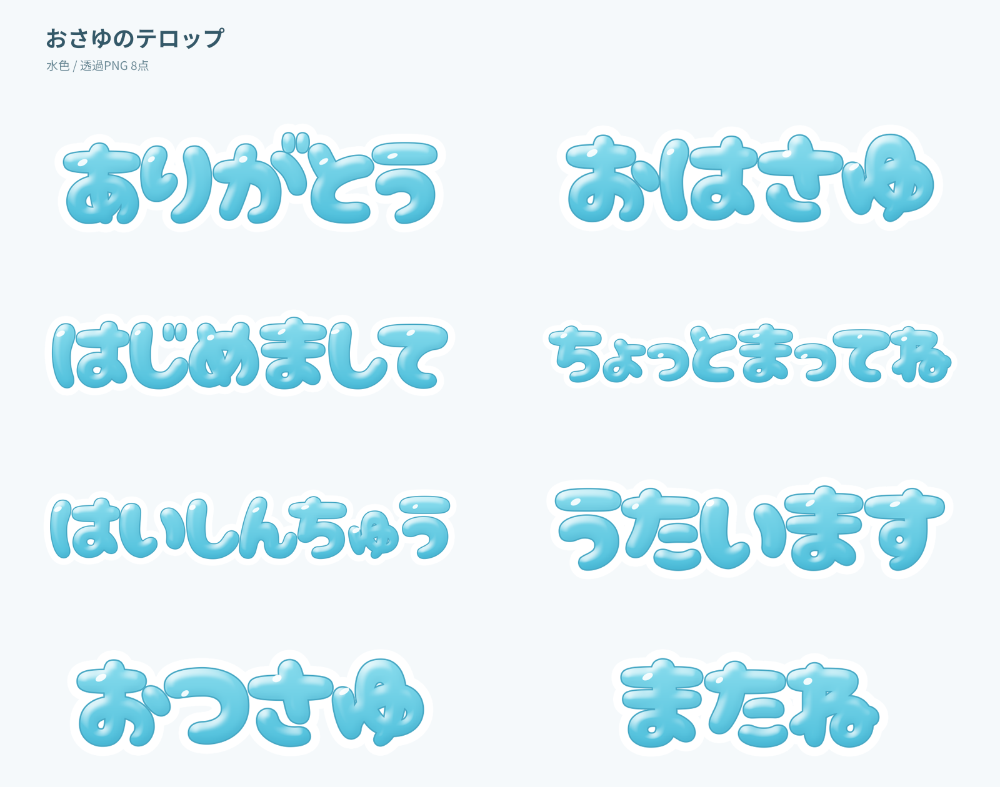

# おさゆの水色テロップ

動画・配信へ重ねる、丸い水色文字と白フチの素材8点。
PhotoCraftの文字・レイヤースタイル・図形で制作しています。

[iPhone向け素材ZIP](delivery/osayu-telop-iphone.zip) / [見本一覧](delivery/preview.png)



## iPhoneのibisPaintで使う

ZIPを「ファイル」に保存して展開し、`PNG`の画像をibisPaintのキャンバスへ読み込みます。
PNGには色・ツヤ・白フチが含まれ、背景が透明です。
`おさゆ_レイヤー素材.psd`では8つの言葉を別々の画像レイヤーとして移動できます。

フォント追加用に、作者Satsuyakoの既存書体**Cherry Bomb One**の元TTF・OFLを同梱しています。
ひらがな・カタカナを中心とする書体です。TTFの色や装飾は入力先で設定します。
文字素材の装飾はPhotoCraftで作成したものです。
[フォントの出典](https://github.com/google/fonts/tree/main/ofl/cherrybombone)

ibisPaintの公式手順では、外部ブラウザで取得したファイルを共有から取り込みます。
詳しい手順と文字一覧はZIP内の`はじめに.txt`にあります。
[フォント取り込みの公式案内](https://ibispaint.com/historyAndRights.jsp?newsID=290994073)、
[PNG・PSD取り込みの公式案内](https://ibispaint.com/newFeature.jsp?lang=ja)

## 制作と再現

対象: [管理Issue149](https://github.com/Pui-core/-/issues/149)。
元の参照画像・キャラクター画像を含みません。
ベース書体をWindowsへ同梱ファイルと同じ版で追加し、PhotoCraft CLIとImageMagickを用意します。
ImageMagickは透過の測定とツヤ配置用の画素測定に使用します。描画・編集はPhotoCraftが行います。

```bash
export OSAYU_TELOP_ROOT=/home/pui/Videos/Osayu-Telop/2026-10-29
# $OSAYU_TELOP_ROOT/assets/cherry-bomb-one/ に元TTF・OFL・METADATA.pbを配置
node source/build.mjs
node source/package.mjs
```

`source/build.mjs`が字形、装飾、文字ごとのツヤ、トリムを含む再現用の正本です。
処理中に残すcommands JSONは基本スタイルのみで、全操作を表すものではありません。
`source/package.mjs`はPhotoCraft原本を再読込し、PNG・8画像レイヤーのPSD・iPhone用ZIPを検査して納品します。
Windows納品の`PhotoCraft`に、色文字・白フチの2つの編集可能な文字レイヤーと独立したツヤ図形を持つ原本8点があります。
文言を変更した場合は、ツヤ配置と余白を再制作・再検査してください。

## 確認範囲

- 8点の透明画素・非透明画素と24pxの外周余白を実測。
- Windows納品先の原本8点をPhotoCraftで再読込・保存・PNGへ書出し、元PNGとSHA一致。
- PSDの8画像レイヤーと、PhotoCraft原本／PSDの合成PNG一致。
- 担当者が文字だけの一覧を目視。ベース書体の元TTFとWindows導入済みTTFのSHA一致。
- ZIP展開検査。結果は[validation.json](validation.json)。

iPhone実機とibisPaint内での取り込み・表示、ownerの創作採用は未確認です。
