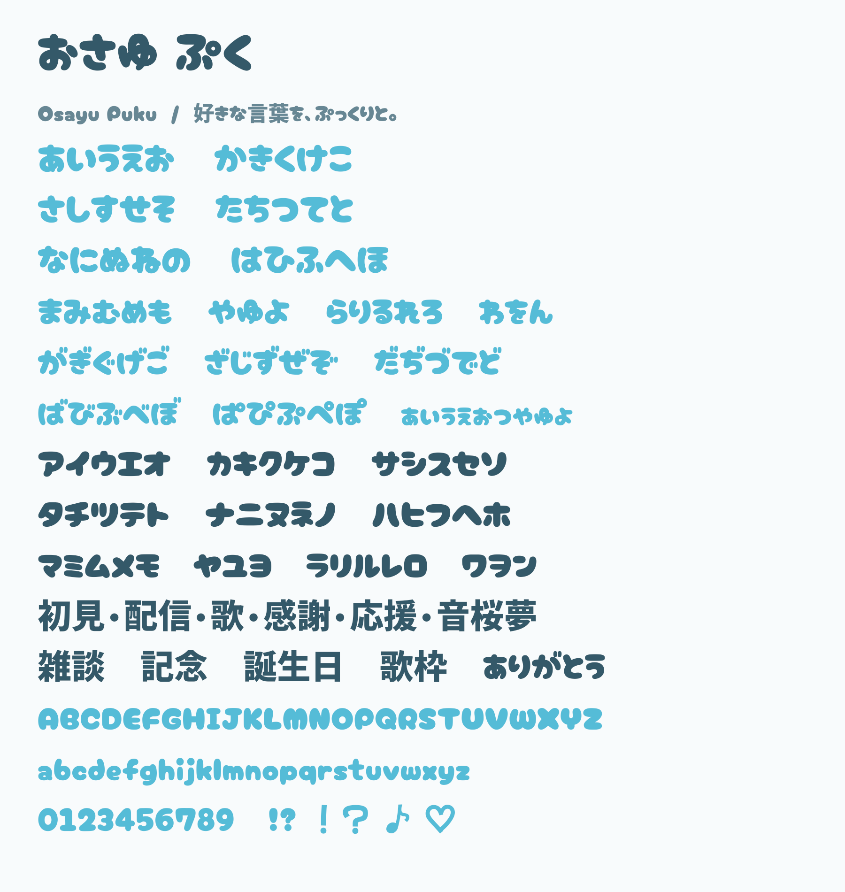

# おさゆ ぷく — Osayu Puku

おさゆの動画・配信に使う、丸く太い字のフォントです。
iPhoneのibisPaintへ追加して、好きな言葉を入力できます。

[フォント本体 TTF](font/OsayuPuku-Regular.ttf) / [iPhone向け一式ZIP](delivery/osayu-telop-iphone.zip)



## ibisPaintへ追加

1. iPhoneでTTFを「ファイル」に保存します。ZIPの場合は展開します。
2. `OsayuPuku-Regular.ttf`を長押し→共有→ibisPaintを選びます。
3. 文字入れのフォント一覧から「おさゆ ぷく」または「Osayu Puku」を選び、好きな言葉を入力します。

外部ブラウザで取得したファイルを共有する方法は、[ibisPaintの公式案内](https://ibispaint.com/historyAndRights.jsp?newsID=290994073)に基づきます。
iPhone実機とibisPaint内での取り込み・表示は未検証です。

## 水色のぷっくり文字にする

TTFには字形が入っています。色・白フチ・ツヤはibisPaintで設定します。

1. 文字入れの「スタイル」で文字色を`#70D0E7`、ふちどりを白にします。
2. 元の文字レイヤーを複製して残し、加工用の複製へ「ベベル (内側)」を使います。
3. 光源を左上にし、高さ・滑らかさ・ハイライトの大きさを調整します。文字を変えたときは効果を掛け直します。

これは見本へ近づける調整手順です。設定値は文字サイズへ合わせて調整します。
[文字装飾の公式案内](https://ibispaint.com/lecture/index.jsp?lang=ja&no=37)、
[ベベルの公式案内](https://ibispaint.com/lecture/index.jsp?no=113)


ZIPには装飾済み透過PNG8点と、言葉ごとの画像レイヤーを持つPSDも含みます。
詳しい取り込み・装飾手順はZIP内の`はじめに.txt`を参照してください。

## 字形と出典

PhotoCraftで英数字・かな・記号294文字をアウトライン化し、横幅・高さ・丸い輪郭・間隔を調整しました。
TTFコンパイラでこれらの実輪郭を組み立て、漢字等はMochiy Pop Oneから継承しています。
常用漢字2,136字とJIS第1・第2水準の漢字6,355字を含む、日本語向けの収録範囲です。
文化庁の[常用漢字の公式音訓索引](https://www.bunka.go.jp/kokugo_nihongo/sisaku/joho/joho/kijun/naikaku/kanji/joyokanjisakuin/)の全字と、JIS漢字の輪郭・文字コードを検査します。
横書きの表示用として検証し、全漢字・絵文字・縦書きへの対応は保証しません。

Cherry Bomb One（Satsuyako）とMochiy Pop One（FONTDASU）に基づく**OFL-1.1の派生書体**です。
元の著作権表示とライセンスを`font`およびZIPへ同梱しています。
[Cherry Bomb One](https://github.com/google/fonts/tree/main/ofl/cherrybombone)、
[Mochiy Pop One](https://github.com/google/fonts/tree/main/ofl/mochiypopone)

## 制作と再現

対象: [管理Issue149](https://github.com/Pui-core/-/issues/149)。元の参照画像・キャラクター画像を含みません。
`source/extract-glyphs.mjs`がPhotoCraftから実輪郭を取得し、`source/compile-font.py`がTTFへ変換します。
`font/native-glyphs.json.gz`に取得した輪郭を保存しています。`requirements-font.txt`はコンパイラ依存の固定版です。

```bash
export OSAYU_TELOP_ROOT=/home/pui/Videos/Osayu-Telop/2026-10-29
# assetsに出典と同じ元TTF/OFLを配置し、WindowsにCherry Bomb Oneを追加
node source/extract-glyphs.mjs
# font配下の日本語文字一覧をROOT/kanji-qaへ配置
# タスク専用venvへ source/requirements-font.txt を導入
font-venv/bin/python source/compile-font.py
# 作成したOsayu PukuをWindowsに追加してから実行
node source/build.mjs
node source/package.mjs
node source/font-proof.mjs
```

輪郭取得の入力文字はCherry Bomb OneのASCIIおよびU+3000〜30FFの294文字です。
`source/build.mjs`はフォントを用いたPhotoCraftの装飾見本、ツヤ配置と余白の制作正本です。
基本commands JSONだけでは全操作を表しません。
Windows納品先の`PhotoCraft`には編集可能な文字と独立したツヤ図形の原本があります。

## 確認範囲

- TTF全字形の構造、294文字の穴と輪郭方向、元書体の対応文字の保持、二度のコンパイル一致。
- 作成TTFをWindowsへ追加し、PhotoCraftで自由入力のかな・漢字・英数字と編集可能な16文字レイヤーを描画・再保存・再描画。
- 使用TTFとWindows追加済みTTFのSHA一致。
- 装飾8点の透過・外周24px余白、納品先原本の再読込とPNG一致、PSDの8画像レイヤーと合成一致、ZIP展開。
- 担当者による最終一覧とフォント見本の目視。

検査記録: [validation.json](validation.json)、[font-proof.json](font-proof.json)。
iPhone／ibisPaintの実操作とownerの創作採用は未確認です。
