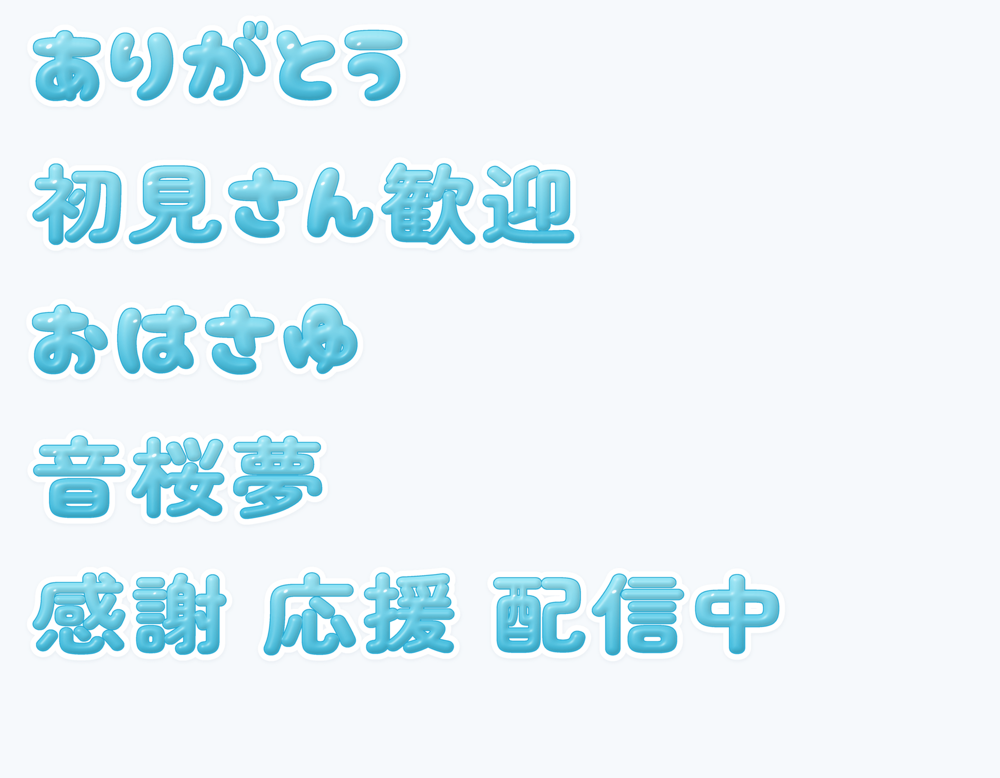

# おさゆ ぷくシール v2

水色・白フチ・柔らかなツヤを埋め込んだカラーフォントです。丸いかなに合わせ、漢字をZen Maru Gothic Black由来の丸い輪郭へ変更しました。
納品先はowner指定のNAS `gara` 直下です。大容量TTFはNASへ置き、このディレクトリには制作原本・見本・検査記録を保存します。

| NAS上のファイル | 内容 |
| --- | --- |
| `おさゆ_ぷくシール_色付き_v2.ttf` | 主版。SBIX、256ppemのツヤ画像を全字に内蔵。約164MB |
| `おさゆ_ぷくシール_色付き互換_v2.ttf` | COLRv0のベクター版。ツヤを簡略化した軽い別表現。約17MB |
| `おさゆ_ぷくシール_見本_v2.png` | 最終のフォントを使った実描画見本 |
| `おさゆ_ぷくシール_使い方_v2.txt` | ibisPaintへの追加方法と注意点 |
| `おさゆ_ぷくシール_v2_ライセンス/` | 派生元3書体の著作権・OFL |



通常版の一覧名は「おさゆ ぷくシール / Osayu Puku Jelly」、互換版は「おさゆ ぷくシール 互換 / Osayu Puku Jelly Compat」です。
TTFの共有から追加する導線は[ibisPaint公式](https://ibispaint.com/historyAndRights.jsp?newsID=290994073)を参照しています。
**iPhoneとibisPaint内の表示は未検証です。ownerの現行指示に従い、実機確認はownerが行います。** Macでの成功をibisPaintの成功として扱いません。

## 字形と材質

- PhotoCraft由来のかな・英数字・記号294文字の輪郭を維持。漢字6,355字をZen Maru Gothic Blackで置換し、高さを90%へ光学調整。
- Zen側にない正規の常用字体「𠮟塡剝頰」はMochiy由来の輪郭を維持。7,088コードポイント、常用2,136字・JIS漢字6,355字を保持。
- 主版は輪郭の距離場から柔らかな膨らみを描き、左上の反射を輪郭内に配置。2倍で描画し縮小した透明PNGを埋め込みます。
- 色の量子化はlibimagequantを使用。白・黒背景のPSNRと実際の階調を比較し、目立つ階調帯が出たFastOctree案は採用していません。
- 白フチが後続文字の水色を切らないよう、描画位置と字送りを調整しています。両版で同じ字送りを使います。

大きく拡大したとき主版の画像は解像度の制約を受けます。互換版は拡大できますが、主版の滑らかな材質とは異なります。

## PhotoCraft原本

[jelly-material.pcraft](jelly-material.pcraft) は「ありがとう」「初見さん歓迎」の影・白フチ・輪郭・本体・反射を独立した10レイヤーにした材質原本です。
ネイティブ再読込とPNG再書出しで一致を確認しています。[材質見本](preview.png) と、実フォントから描画した上の見本は別の検証対象です。

## 再現

Python依存は `../source/requirements-color-font.txt`。旧版のTTFを入力に使うため、元の `font/OsayuPuku-Regular.ttf` を保持します。
Zen Maru Gothic BlackとOFLを[公式配布](https://github.com/google/fonts/tree/main/ofl/zenmarugothic)から用意し、`build-rounded-base.py --help` の入力パスを指定します。

```bash
python source/build-rounded-base.py --help
python source/compile-color-font.py sdf --base /path/to/OsayuPukuJelly-Base.ttf \
  --output /path/to/delivery --style source/jelly-style.json --workers 8
python source/build-color-backup.py --help
node source/compose-jelly-preview.mjs /path/to/material-prototypes/sdf-jelly-v4
```

`test-coretext.swift` は実フォントをCoreTextへプロセス内登録し、入力色を赤にして埋め込みの水色と区別します。
`deliver-jelly-fonts.ps1` は指定先へ直接コピーし、既存の異なるファイルを上書きせず、送受信SHA256を照合します。NASの接続先は引数で渡し、ソースへ保存しません。

## 出典と確認範囲

OFL-1.1派生書体です。Cherry Bomb One、Mochiy Pop One、Zen Maru Gothicの著作権表示とOFLをこのディレクトリにも保存しています。
全字の構造検査、実フォントのCoreText描画、PhotoCraft原本往復、NASコピー一致を検査記録へ分けて保存します。
創作採用・iPhone/ibisPaintの動作・実売上は未確認です。

検査結果: [全体](validation.json)、[SBIX全字独立監査](sbix-independent-qa.json)、[主版の実描画](sbix-coretext-receipt.json)、[互換版の実描画](colr0-coretext-receipt.json)、[PhotoCraft往復](photocraft-roundtrip-qa.json)、[NASコピー照合](nas-delivery.json)。

対象: [管理Issue149](https://github.com/Pui-core/-/issues/149)。旧単色版とその制作物は履歴・補助素材として保持しています。
